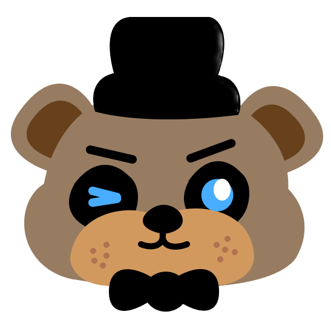
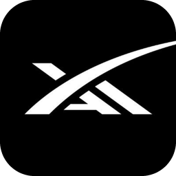

<h1 align="center">
  
  Five Nights with AI
</h1>

<p align="center">
  
  &nbsp;&nbsp;
  
  &nbsp;&nbsp;
  <picture>
    <source media="(prefers-color-scheme: dark)" srcset="assets/tesc-logo-white.png">
    
  </picture>
</p>

<p align="center"><sub><b>SPONSORED BY</b></sub></p>

<p align="center">
  
  &nbsp;&nbsp;
  
  &nbsp;&nbsp;
  
</p>

Welcome to ACM AI's Fall 2026 Competition, **Five Nights with AI**! In this competition, you will train your models to predict anomalies from artificially made images from the video game Five Nights at Freddy's. Compete against your peers to win cool prizes!

> [!NOTE]
> **This starter kit is for Track 1 (Highest Accuracy Model).** It sets up your environment, downloads the dataset, and gives you a working baseline that produces a leaderboard submission. Tracks 2–4 are judged separately and don't need this kit, though you're welcome to use it.

<p align="center">
  
  <br>
  <b>Scan this QR code to access Voiskey Pro for 2 months.</b>
  <br>
  Can't scan it? Use this link instead: <a href="https://www.voiskey.ai/gift/PRODUCTSC">https://www.voiskey.ai/gift/PRODUCTSC</a>
</p>

## Competition Timeline
| Time | Event | Location |
|------|-------|----------|
| 8:00 - 9:00 AM | Check-in | Jacobs Hall |
| 9:00 - 9:30 AM | Opening Ceremony | Henry Booker Room |
| 9:30 AM | Competition Starts | CSE Building |
| 9:45 - 10:15 AM | Voiskey Workshop | CSE B250 |
| 10:15 - 10:45 AM | Voiskey Tech Talk | CSE B250 |
| 12:00 PM | Lunch | CSE Lobby |
| 1:00 - 1:30 PM | SpaceX AI Workshop | CSE B250 |
| 1:30 - 2:00 PM | Google Workshop | CSE B260 |
| 4:00 PM | Competition Ends |  |
| 4:00 - 4:15 PM | Breaktime | CSE Basement |
| 4:15 - 5:00 PM | Judging Begins | CSE B250 |
| 5:30 PM | Closing Ceremony | Henry Booker Room |

## Table of Contents
- [Tracks](#tracks)
- [Rules](#rules)
- [How the competition works](#how-the-competition-works)
- [Quick start](#quick-start)
- [Repo structure](#repo-structure)
- [Glossary](#glossary)
- [Resources](#resources)

## Tracks
- Track 1: Highest Accuracy Model
- Track 2: Best Use of Voiskey
- Track 3: Best Use of Google Gemini
- Track 4: Best Use of GrokBots

## Rules
- Do not share code with other competing teams
- Any Python packages and libraries are allowed
- Maximum team size of 3 people
- Track 1 Specific: 200 submissions at most per team
- Track 1 Specific: Do not hardcode/handwrite the submission data
- Teams can enter multiple tracks, but may only win one prize

## How the competition works

Each **sequence** is a short run of 10 security-camera frames from a Five Nights at Freddy's scene. A sequence is **anomalous** if an animatronic does something it shouldn't in *any* of its frames. You predict one thing per sequence: **does it contain an anomaly, yes or no?**

You learn from `train/` (which comes with the answers), then predict every sequence in `test/` (which doesn't) and upload one CSV covering all of them:

```csv
sequence_id,has_anomaly
test_00000,FALSE
test_00001,TRUE
test_00002,FALSE
```

Your score is **F1** on the anomalous class, so missing a real anomaly and raising a false alarm both cost you. Predicting "no anomaly" everywhere scores zero. Behind the scenes the server splits the test sequences into a **public** part and a **private** part, and you aren't told which is which. The public score drives the live leaderboard; the private score is hidden until the end and **decides the final ranking**.

Only your team's **last valid submission** counts. The hidden private score determines the leaderboard ranking. Make sure your final upload is your best!

**Time is challenging.** This is a short competition, and training on every sequence at full resolution can take hours. The baseline trains on a slice of the data at reduced resolution so your first run is quick. Can you iterate on a model and strategy in a short amount of time? Keep track of the time!

<sup>**P.S.** If you like multi-tasking, you could work on other tracks while training!</sup>


## Quick start

1. **Get the starter kit** onto your laptop and open a terminal inside it:
   ```bash
   git clone https://github.com/acmucsd/Five-Nights-With-AI-Starter-Kit.git
   cd Five-Nights-With-AI-Starter-Kit
   ```
   (No git? Use **Code → Download ZIP** on GitHub, unzip it, and open a terminal in that folder.)
2. **Run the setup** (about ten minutes, mostly downloading):
   ```bash
   ./setup.sh
   ```
   It stops at the first problem and finishes with `Everything works.`
3. **Run the baseline**, which trains on `data/train`, predicts every sequence in `data/test` and writes `submission.csv`:
   ```bash
   .venv/bin/python baseline.py
   ```
4. **Improve it.** Edit `baseline.py` to build your own model; [`resources/train_model.md`](resources/train_model.md) explains how it works.
5. **Check it, then upload it**:
   ```bash
   .venv/bin/python check_submission.py submission.csv
   ```
   (Windows Git Bash: `.venv/Scripts/python.exe`.)

You never *have* to read the rest of this page to compete. But if you are curious what `setup.sh` actually does to your computer, and why each piece exists, that is what the setup guide below is for. It is written to teach: skim it, or work through the **Try it yourself** boxes.

## Repo structure

```
Five-Nights-With-AI-Starter-Kit/
├── README.md              you are here: competition info + the full setup guide
├── setup.sh               runs the four setup steps in order
├── scripts/               the setup steps, one script each (+ a shared helper)
├── requirements.txt       the Python packages we install
├── baseline.py            the baseline model: train, validate, write submission.csv (edit this!)
├── dataset.py             loads the data into PyTorch (read this one!)
├── check_submission.py    checks your CSV before you upload it
├── verify_setup.py        the end-to-end test that step 4 runs
├── resources/             guides: how to train a model and improve it
├── assets/                logos and images used by this README
├── .venv/                 your private Python environment    (created by step 2)
└── data/                  the competition dataset            (created by step 3)
    ├── train/             sequences + labels.csv: learn from these
    └── test/              sequences, no labels: what you predict and submit
```

## Glossary

| Term | Meaning |
|---|---|
| **Tensor** | A multi-dimensional array of numbers; the basic data type of PyTorch |
| **Batch** | A group of items processed together, for efficiency |
| **Epoch** | One full pass over the training data |
| **Forward pass** | Feeding input through the model to get a prediction |
| **Loss** | A number measuring how wrong the predictions are; training tries to shrink it |
| **Pretrained model** | A network already trained on a big dataset, reused as a starting point |
| **Transfer learning** | Adapting a pretrained model to a new task |
| **Overfitting** | Memorizing the training data instead of learning the pattern; shows up as a gap between train and test scores |
| **F1 score** | A single number balancing precision (few false alarms) and recall (few misses) |
| **Virtual environment** | A project-private set of installed Python packages |
| **Wheel** | A pre-built, installable Python package file |
| **Idempotent** | Safe to run repeatedly; the second run changes nothing |

## Resources
- [`scripts/SETUP.md`](scripts/SETUP.md): every script, what it does and why
- [`resources/train_model.md`](resources/train_model.md): train and submit a baseline model
- [AI School 1: Classification](https://docs.google.com/presentation/d/1dD-62sM_-41969Nv0U7LQVH0JdOUP-DWsun9JGkZys0/edit?usp=sharing) (slides): an intro to classification models, the kind of model this competition asks for
- [Competition dataset (Google Drive)](https://drive.google.com/drive/folders/1LATNw4NgEYQKQB3j3AwkOT8TWfOF9C3A?usp=sharing): `train.zip` and `test.zip`. `./setup.sh` downloads these for you; use this link if you want to download them by hand
- [ACM AI Site](https://ai.acmucsd.com/)
